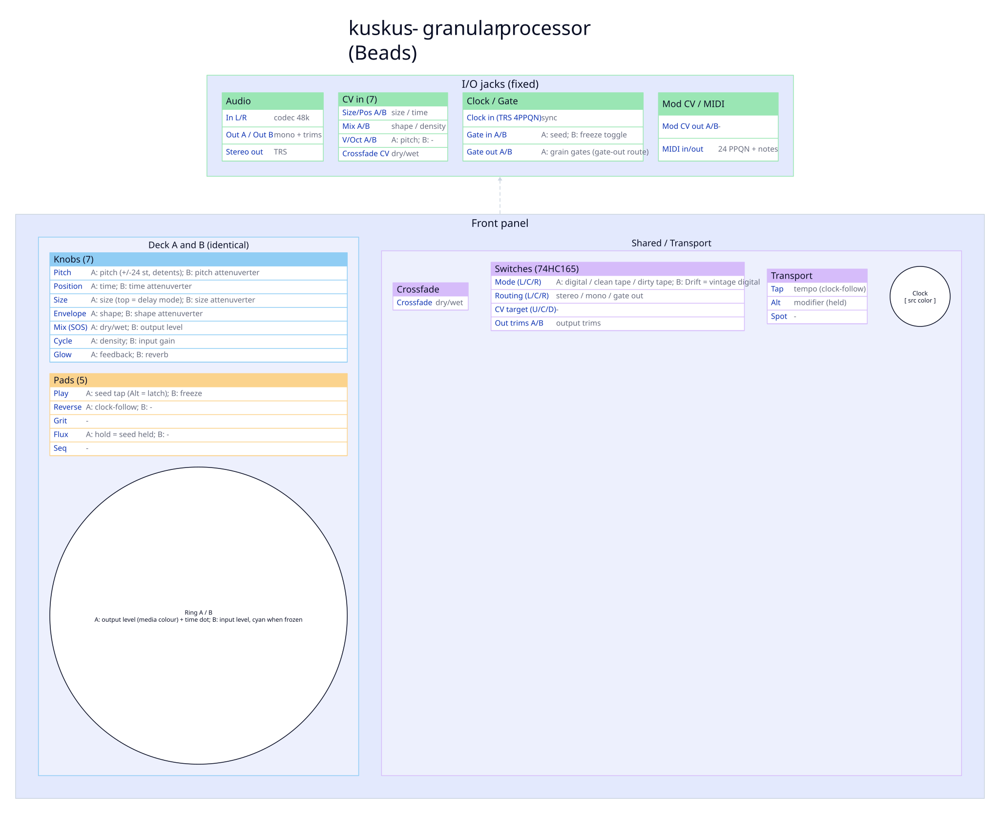

# kuskus engine

A port of the Mutable Instruments **Beads** granular processor (`src/engine/kuskus/thirdparty/beads`). One stereo Beads instance runs across both decks: deck A carries Beads' main knobs, deck B its attenuverters and mix extras. Beads records the input into a delay line and plays up to 32 grains from it. At the top of SIZE travel it becomes an 8-tap delay. Output passes through Beads' own reverb and limiters.

> Design, the platform-fit analysis and open decisions: [`docs/dev/kuskus.md`](../dev/kuskus.md).

A normal SRAM build: `make ENGINE=kuskus` or `make engine-kuskus`. No SD card is used.

---

## Control map

*Generated from [`docs/diagrams/controls/kuskus.json`](../diagrams/controls/kuskus.json) via `make diagrams`.*

| Control | Deck A | Deck B |
|---|---|---|
| PITCH | PITCH, +/-24 semitones with detents at 0, 1, 3, 4, 7, 12, 24 | PITCH attenuverter |
| POS | TIME (how far back grains start) | TIME attenuverter |
| SIZE | SIZE; top of travel = delay mode | SIZE attenuverter |
| ENV | SHAPE (grain envelope) | SHAPE attenuverter |
| MODFREQ | DENSITY | input gain, -12..+12 dB, unity at noon |
| MOD_AMT | FEEDBACK | REVERB |
| SOS | dry/wet | output level, unity at noon |
| Crossfader | dry/wet (shared with SOS A; the last one moved wins) | |

An attenuverter at noon adds nothing. Turned either way it randomises its parameter per grain, as on Beads with nothing patched. Clockwise mixes a fixed share of a random value into every grain. Counter-clockwise varies that share per grain, so some grains keep the knob value. In delay mode the PITCH attenuverter drives a random walk instead.

DENSITY follows Beads: below noon, regular grains that get faster as you turn left; above noon, random grains that get denser as you turn right. The band at noon is manual: grains fire only on a SEED.

## Pads and gestures

| Gesture | Action |
|---|---|
| Play A | SEED tap: one grain (or a phase reset), and unlatches SEED |
| Flux A (hold) | SEED held: grains run at DENSITY while held |
| Alt + Play A | latch / unlatch SEED (boots latched, as Beads does) |
| Rev A | clock-follow on/off: transport quarter notes become SEED pulses |
| Play B | FREEZE on/off: the buffer stops recording |

With SEED latched and pulses arriving (gate in A, MIDI notes, or clock-follow), DENSITY divides or thins the clock instead of free-running, as Beads does with a clock patched into SEED.

## Switches

| Switch | Positions |
|---|---|
| Mode A | media: Slice = Digital, Reel = Clean Tape, Drift = Dirty Tape |
| Mode B | Drift = Vintage Digital (overrides Mode A); other positions = off |
| Routing | Stereo; DoubleMono = mono buffer (twice the length); GenerativeStereo = gate out |

| Media | Buffer | Character |
|---|---|---|
| Digital | 4 s, 16-bit, 48 kHz | clean |
| Clean Tape | 10.7 s, 12-bit, 24 kHz | soft-clipped feedback, darker reverb |
| Dirty Tape | 16 s, 8-bit mu-law, 24 kHz | mu-law dry path, wow and flutter |
| Vintage Digital | 10.7 s, 12-bit, 24 kHz | 12-bit dry path |

Beads ran Vintage Digital at 32 kHz. The Spotykach codec is fixed at 48 kHz, so kuskus runs it at 24 kHz, like Clean Tape.

Changing media or mono clears the buffer, as on Beads. The output fades out, the buffer is reconfigured on the main loop, and the output fades back in.

In the gate-out route, L carries the mono mix and R a +0.8 gate per grain. Each grain also pulses gate out A.

## CV, gates and MIDI

| Input | Destination |
|---|---|
| V/Oct A | PITCH (added, in semitones) |
| SIZE/POS CV A / B | SIZE / TIME (added to the knob) |
| MIX CV A / B | SHAPE / DENSITY |
| Crossfade CV | dry/wet |
| Gate in A | SEED (delayed 2.5 ms, as Beads delays its SEED jack) |
| Gate in B | FREEZE toggle |
| MIDI note | a SEED pulse; PITCH offset = note - 60 |

The Spotykach cannot detect which jacks are patched. Every CV is added to its knob and never turns an attenuverter into a CV depth, as it would on Beads.

## Display

- Ring A: output level in the media colour, dimmed as a thawed buffer nears full overwrite; a white dot at TIME.
- Ring B: input level; a full cyan ring while frozen.
- Play A: SEED. Breathes while latched, flashes on each SEED.
- Play B: FREEZE. Rev A: clock-follow.
- L/C/R LEDs: the route. Faders: the dry/wet balance.

## Not ported

The Synth (wavetable) mode, buffer backup to flash, CV calibration, and Beads' AGC (replaced by the fixed input gain).
